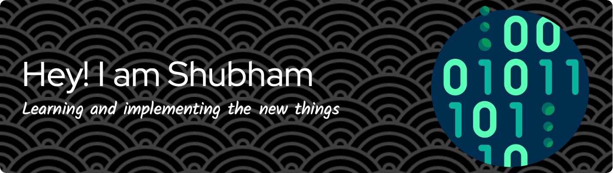

 
  <h3>Shubham Tripathi</h3> 
<b>Full Stack Developer</b> &nbsp;|&nbsp; Java (Spring Boot) &amp; React &nbsp;|&nbsp; Microservices, Event-Driven Systems &amp; AI Backends
 
📍 Bhopal, India &nbsp;·&nbsp; 🎓 B.Tech CSE @ VIT Bhopal (2023–2027)

    

  

<!-- PORTFOLIO BADGE: swap the href below if your portfolio URL changes -->  
  
 <table> <tr> <td align="center" width="25%"><h3>9.33</h3>CGPA · VIT Bhopal</td> <td align="center" width="25%"><h3>2× AWS</h3>Certified · SAA &amp; AIF</td> <td align="center" width="25%"><h3>700+</h3>DSA / CP Problems</td> <td align="center" width="25%"><h3>10</h3>Microservices in HireSphere</td> </tr> </table> 

01 About
I build secure, scalable backends and the products on top of them — from Spring Boot microservices talking over Kafka, to React dashboards behind enterprise SSO, to AI features wired into real workflows. I care about clean architecture, observable failure modes, and code that's easy for the next engineer to read.

public class ShubhamTripathi {

    String role        = "Full Stack Developer — Java (Spring Boot) & React";
    String currently   = "Software Development Intern @ EXL";
    List<String> focus = List.of("Microservices", "Event-Driven Systems", "AI Backends");
    String education   = "B.Tech CSE @ VIT Bhopal · 2023–2027 · CGPA 9.33";
    List<String> certs = List.of("AWS SAA-C03", "AWS AIF-C01");
    int problemsSolved = 700; // and counting

    String ping() { return "theshubhamtripathi06@gmail.com"; }
}
02 Experience
🏢 Software Development Intern · EXL
<b>Nov 2026 – May 2027</b>  ·  Enterprise Employee Project & Allocation Dashboard

Full-stack platform — Built an enterprise dashboard with React, Java Spring Boot & Microsoft SQL Server; REST APIs on the Controller-Service-Repository pattern with DTOs, Spring Data JPA/Hibernate and Pageable pagination.
Enterprise SSO & RBAC — Secured frontend routes and backend endpoints with Microsoft Entra ID SSO (OAuth 2.0 / OpenID Connect), MSAL, Spring Security and JWT validation, enforcing EMPLOYEE / MANAGER roles.
Analytics & quality — Shipped utilization and skill-distribution dashboards (Recharts / Chart.js) with multi-filter search, backed by global exception handling, OpenAPI/Swagger docs and JUnit/Mockito tests.
        

03 Featured Projects
<table> <tr> <td width="50%" valign="top"> <h3>🚀 HireSphere</h3> 
<b>AI-Powered Job Portal</b> — a production-style microservices platform with AI-assisted hiring workflows.
 
         
 <ul> <li><b>10 Spring Boot microservices</b> behind an API Gateway — Eureka, Config Server, DB-per-service</li> <li><b>JWT + RBAC</b> auth, <b>Redis rate limiting</b> &amp; <b>Resilience4j</b> circuit breakers</li> <li><b>6 Kafka topics</b> driving async, event-driven workflows</li> <li><b>8 Gemini AI features</b> + Razorpay payments</li> <li>CI with <b>GitHub Actions</b> &amp; <b>Testcontainers</b> integration tests</li> </ul>  </td> <td width="50%" valign="top"> <h3>🔗 SwiftURL</h3> 
<b>URL Shortener Service</b> — a lean, well-tested backend service built on a clean layered architecture.
 
         
 <ul> <li>Clean <b>Controller-Service-Repository</b> layering</li> <li><b>Unique-code constraints</b> for collision-safe short links</li> <li><b>Centralized exception handling</b> &amp; request validation</li> <li>Unit-tested with <b>JUnit + Mockito</b></li> <li><b>Container-ready</b> for one-command deployment</li> </ul>  </td> </tr> </table> 
 
<b>🧭 HireSphere architecture at a glance</b>
  
%%{init: {'theme':'base','themeVariables':{'primaryColor':'#121212','primaryTextColor':'#FFFFFF','primaryBorderColor':'#16C68E','lineColor':'#16C68E','secondaryColor':'#121212','tertiaryColor':'#121212','fontFamily':'monospace'}}}%%
flowchart LR
    UI["React Client"] --> GW["API Gateway JWT · RBAC"]
    GW -.-> RL[("Redis Rate Limiting")]
    REG["Eureka Service Discovery"] -.- GW
    GW --> SVC["10 Spring Boot Microservices Resilience4j Circuit Breakers"]
    CFG["Config Server"] -.- SVC
    SVC <--> K[("Apache Kafka 6 Async Topics")]
    SVC --> DB[("PostgreSQL DB-per-Service")]
    SVC --> AI["Gemini API 8 AI Features"]
    SVC --> PAY["Razorpay"]

04 Tech Stack
Domain	Tools
Languages	

Backend & Distributed Systems	
    
Frontend	
Databases & Caching	
Cloud & DevOps	
05 Credentials & Problem Solving
<table> <tr> <td width="50%" valign="top"> <h3> &nbsp;Certifications</h3>         <h3>🤝 Community</h3>  </td> <td width="50%" valign="top"> <h3>⚔️ Competitive Programming</h3>              </td> </tr> </table>
06 GitHub Analytics

           
  
 <h3>Open to Backend &amp; Full Stack SDE opportunities — let's build systems that scale.</h3>
 

  

   Built with ☕ Java, ⚡ Spring Boot and a lot of curiosity. 
  
