

 

&nbsp;
&nbsp;

  

<!-- PORTFOLIO BADGE: swap the href below if your portfolio URL changes -->

  



 


I build **secure, scalable backends and the products on top of them**: Spring Boot microservices that talk over Kafka, React dashboards behind enterprise SSO, and AI features wired into real workflows. I care about clean architecture, graceful failure, and code the next engineer can read without a guide.

🎓 **B.Tech CSE @ VIT Bhopal** (2023–2027) · CGPA **9.33** &nbsp;|&nbsp; 📍 **Bhopal, India** &nbsp;|&nbsp; 🤝 Technical Core Member, Freelancing Club

 



  


  <a href="https://github.com/theshubhamtripathi/hiresphere"></a>
  <a href="https://github.com/theshubhamtripathi/SwiftURL"></a>

<a href="https://github.com/theshubhamtripathi/hiresphere"></a>

  

| Domain | Tools |
|:--|:--|
| **Languages** |   |
| **Backend & Distributed Systems** |       |
| **Frontend** |  |
| **Databases & Caching** |  |
| **Cloud & DevOps** |  |

 


<table>
  <tr>
    <td width="50%" valign="top">
      <h3> &nbsp;Certifications</h3>
      
        
      
        
      <h3>🤝 Community</h3>
      
    </td>
    <td width="50%" valign="top">
      <h3>⚔️ Competitive Programming</h3>
      
        
      
        
      
        
      
    </td>
  </tr>
</table>

 


  
  
    
  
    
  

 


  

  

